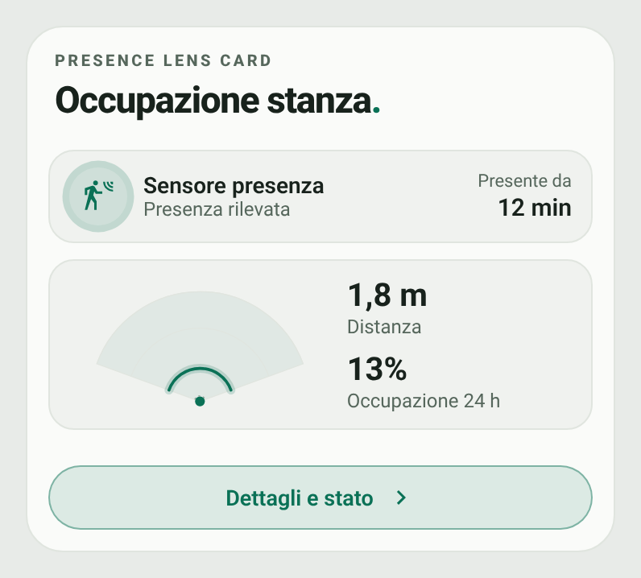
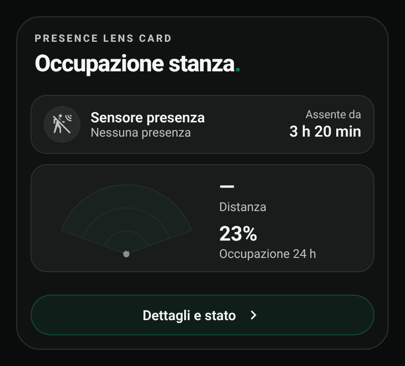
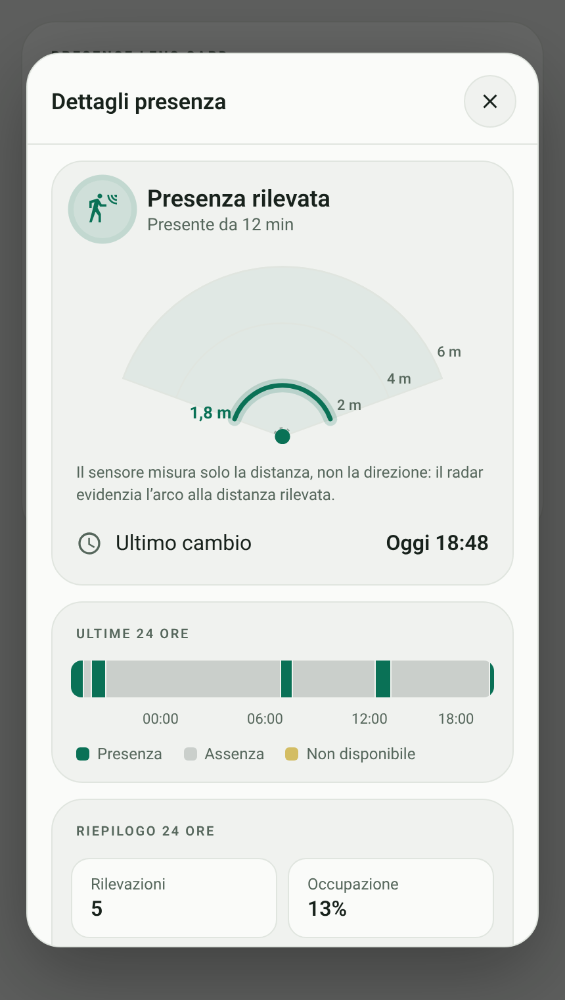
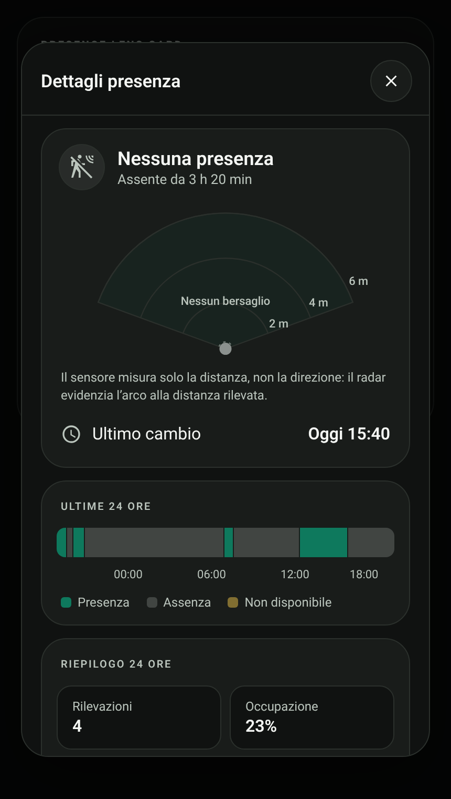

# Presence Lens Card

## Overview

**Presence Lens Card** is a custom presence and radar sensor card for Home Assistant, designed with a minimalist, responsive interface inspired by the Edera Light and Dark visual styles.

It answers one question: is anyone in the room, and for how long? The card shows the state of a presence sensor, the time since the last change, a mini radar of the detected distance and the occupancy of the last 24 hours.

From the details popup you can see the 24-hour history, the sensor values and the list of events, and adjust the radar settings of the sensor. The popup opens read-only; commands are sent only after you unlock the padlock and tap − or +, and this can be turned off in the editor. The card uses entities already configured in Home Assistant, is not tied to a specific device manufacturer and does not require a dedicated account, paid API, or subscription.

## Preview

  
  

  
  

*Presence Lens Card in Edera Light and Dark modes, with its details popup. The previews use demonstration values and do not display private installation data.*

## Features

- **Presence state:** Present, absent and unavailable, each with its own icon and colour.
- **Time since the last change:** "Present for" and "Absent for", as a duration or as a time of day.
- **Mini radar:** Range rings and an arc at the detected distance, with optional minimum and maximum distance entities.
- **Occupancy:** Percentage of the last 24 hours in which presence was detected.
- **24-hour strip:** Optional strip on the card, disabled by default.
- **Details popup:** Last 24 hours summary, sensor values, strip and event history with filters; the full history opens with one tap.
- **Radar settings:** Minimum distance, maximum distance and sensitivity can be adjusted from the popup when they are `number` entities. The popup opens read-only: tap the padlock to unlock the **−** and **+** buttons, tap it again to lock them. Optional, can be turned off.
- **Edera appearance:** Automatic, Light, and Dark themes, a compact layout that adapts to the card width, rounded elements, and native Home Assistant icons.
- **Visual configuration:** Configure sensors, appearance and content through the dashboard editor.

Unavailable or unknown sensors are always reported as "not available" and never shown as an empty room.

## Installation

### HACS — Custom repository

1. Open **HACS** in Home Assistant.
2. Select **Custom repositories** from the menu.
3. Enter `https://github.com/luigi-regolo/presence-lens-card`.
4. Select **Dashboard** as the repository type and add it.
5. Find **Presence Lens Card** in HACS and click **Download**.
6. Reload your dashboard if necessary.
7. Add **Presence Lens Card** to your dashboard and configure it using the visual editor.

### Manual installation

1. Download `dist/presence-lens-card.js` from the GitHub repository.
2. Copy it to the `www` directory of your Home Assistant configuration as `presence-lens-card.js`.
3. Open **Settings → Dashboards → Resources** in Home Assistant.
4. Add the following resource:

   `/local/presence-lens-card.js`

5. Select **JavaScript module** as the resource type.
6. Reload the dashboard and add the card.

If the `www` directory was just created, Home Assistant may need to be restarted before the file becomes accessible.

## Configuration and Usage

### Visual editor

Open a dashboard in edit mode, add **Presence Lens Card**, and configure the available sections:

- **Sensore:** Presence sensor, name, optional distance, minimum distance, maximum distance and sensitivity entities, and whether the padlock in the popup can unlock the radar settings.
- **Aspetto:** Theme, label and title, central panel and radar range.
- **Contenuto:** 24-hour strip, "Present for / Absent for" format and occupancy label.

Without a sensor, the card shows an example.

### Main configuration options

All options are set from the visual editor. The table lists the field names saved in the card configuration.

| Option | Description |
|---|---|
| `entity` | Presence sensor (`binary_sensor`). |
| `name` | Name shown in the sensor row. |
| `distance_entity` | Detected distance (`sensor` or `number`). Distances are always shown in metres. |
| `min_distance_entity` | Minimum detection distance. |
| `max_distance_entity` | Maximum detection distance, used as the radar range. |
| `sensitivity_entity` | Sensitivity, shown in the popup. |
| `allow_edit` | Allows unlocking the **−** / **+** buttons in the popup for minimum distance, maximum distance and sensitivity, when they are `number` entities. Enabled by default; when disabled the popup is always read-only. |
| `panel` | `radar`, `tiles` or `none`. Default `radar`. The radar needs a distance entity. |
| `show_strip` | 24-hour strip on the card. Disabled by default. |
| `since_format` | `duration` or `time`. Default `duration`. |
| `radar_max` | Radar range in metres when no maximum distance entity is set. Default 6 m. |
| `eyebrow` / `title` | Small label above the title and card title. The green dot is added by the card. |
| `show_eyebrow` / `show_title` | Show or hide the label and the title. Enabled by default. |
| `occupancy_label` | Text of the occupancy tile. |
| `theme_mode` | `auto`, `light`, or `dark`. |

Additional settings are available in the visual editor.

## Compatibility and Requirements

Presence Lens Card requires:

- Home Assistant with support for custom JavaScript dashboard cards.
- A presence, occupancy or motion `binary_sensor`.
- HACS only when using the HACS installation method.

Occupancy, the 24-hour strip and the event history require the Recorder history of the sensor. Without it these parts are hidden and the card still shows the state and the time since the last change.

Changing the radar settings from the popup uses the standard Home Assistant service `number.set_value`.

The card interface follows the Home Assistant language, in Italian or English.

No specific minimum Home Assistant version has been independently verified for this repository.

The card does not require a dedicated paid service or additional remote JavaScript libraries.

## Privacy and Security

Presence Lens Card operates through Home Assistant entities and the permissions of the authenticated user.

- The card only reads the configured entities and, for the 24-hour history, the Recorder history through Home Assistant.
- Commands are sent only when you unlock the padlock in the popup and tap **−** or **+** to change a radar setting, with the permissions of the authenticated user. The popup always opens read-only, and editing can be disabled in the editor.
- The card does not include advertising, analytics, telemetry, or user-tracking services.

**Presence Lens Card is not a certified safety, intrusion detection or access control system.** The result only reflects the state reported by your sensor.

Unknown, unavailable, or missing information must not be interpreted as confirmation that nobody is present.

## Copyright & License

Copyright © 2026 luigi-regolo.

Original project created and maintained by **luigi-regolo**.

Licensed under the **GNU General Public License version 3 only (GPL-3.0-only)**.

See the [LICENSE](LICENSE) file for the complete license terms.

The software is provided without warranty to the extent permitted by applicable law.
